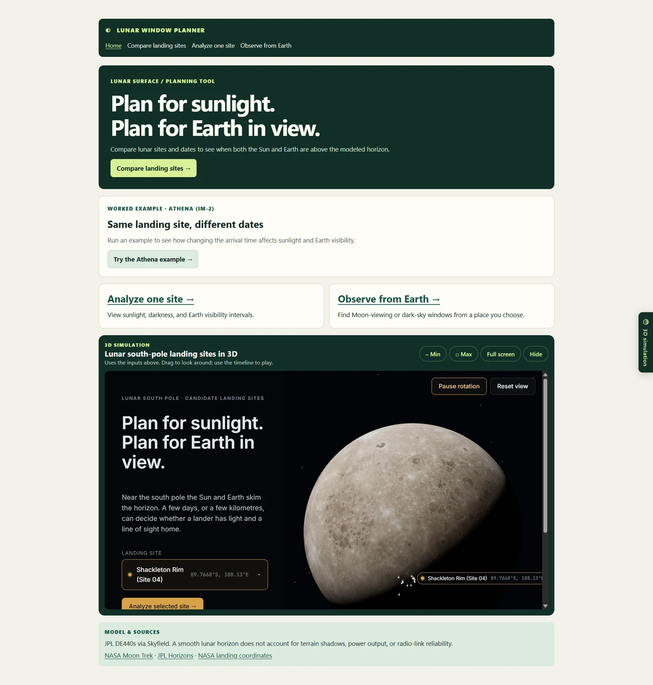
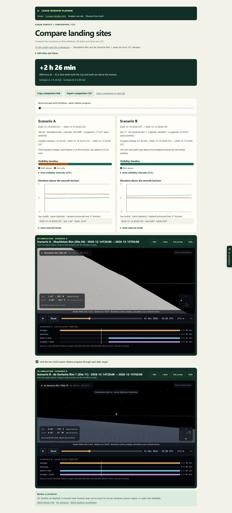
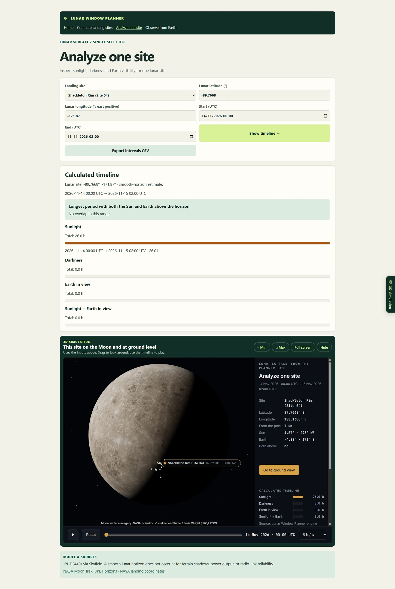
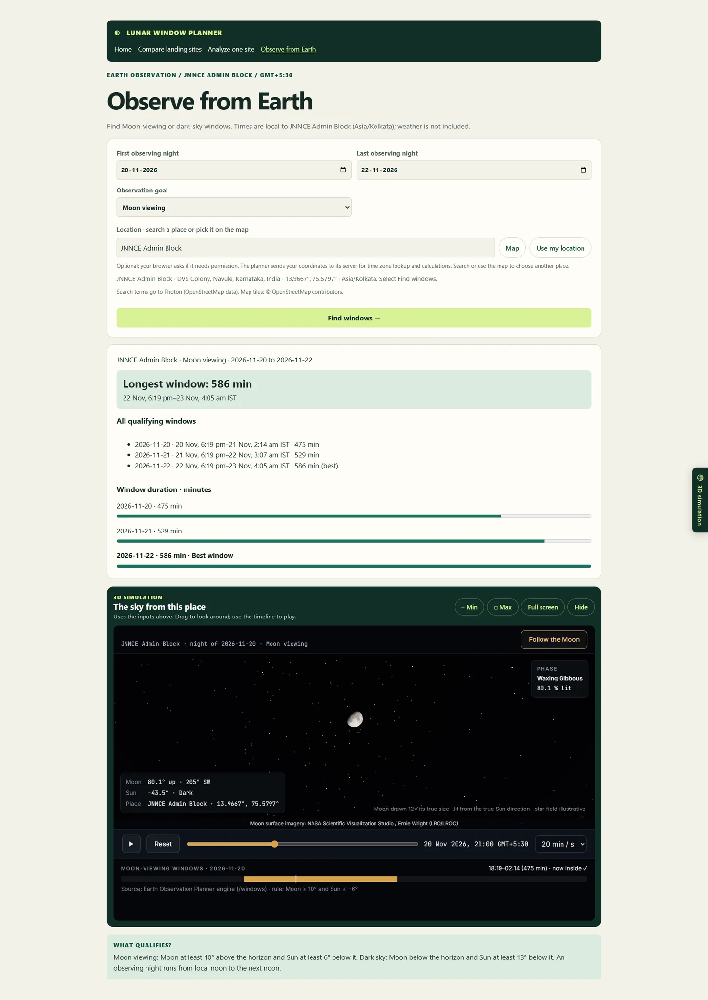

# LunaSpan · Lunar Window Planner

**Compare lunar landing sites and dates by how long they have sunlight and Earth in view at the same time.** LunaSpan also finds Moon-viewing and dark-sky windows from a place on Earth.

[**Live demo**](https://lunar-window-planner.onrender.com/) · [**User guide**](https://lunar-window-planner.onrender.com/user-guide/index.html) · [**Data and credits**](CREDITS.md)

[](https://gitdiagram.com/ullasds007-hub/lunar-window-planner?utm_source=readme&utm_medium=badge)



## Try the south-pole comparison

Open **Compare landing sites → Try the south-pole site comparison**. The two scenarios use the same window: **14 Dec 2026, 20:00 UTC → 15 Dec 2026, 02:00 UTC**.

| Scenario | Landing site | Latitude | Longitude (east-positive) | Sunlight + Earth in view |
| --- | --- | ---: | ---: | ---: |
| A | Shackleton Rim (Site 04) | −89.7668° | −171.87° | 3 h 34 min |
| B | de Gerlache Rim 1 (Site 11) | −88.6834° | −67.9321° | 6 h 00 min |

**Site B has 2 h 26 min more modeled overlap.** At Site A, the Sun is already above the modeled horizon at the start, but Earth isn't. The visibility timeline shows the change from **Sun only** to **Both above**. Open **3D simulation** to explore both sites, or use **Copy comparison link** and **Export comparison CSV** to share the result.

<details>
<summary>Compare screenshot</summary>



</details>

## Explore all four pages

| Page | What to try |
| --- | --- |
| **Home** (`/`) | Select **Try the Athena example** to compare two date ranges at the same site, or open the 3D globe and pick a landing-site pin. |
| **Compare landing sites** (`/lunar-surface/compare`) | Try the two-site example above. To change the time instead of the site, use **Compare a landing delay** with a 6-hour window and a 72-hour delay at Shackleton Rim. **Link the two clocks** synchronizes the 3D panels by relative progress, even if their dates differ. |
| **Analyze one site** (`/lunar-surface/`) | Pick **Shackleton Rim (Site 04)** and enter the same UTC window as above. Select **Show timeline** to see sunlight, darkness, Earth visibility, and overlap. Use **Export intervals CSV** or open the 3D globe and select **Go to ground view**. |
| **Observe from Earth** (`/earth`) | Search for **JNNCE Admin Block**, use **20–22 Nov 2026**, and choose **Moon viewing**. Select **Find windows**, then open the 3D sky view. Switch the goal to **Dark sky** to try the other mode. |

Lunar presets include south-pole candidate sites and the Odysseus (IM-1) and Athena (IM-2) landing sites. You can also enter custom lunar coordinates. Lunar times are in **UTC**; Earth observing times are local to the selected place.

On **Observe from Earth**, you can search for a place, pick one on the map, or select **Use my location**. That button asks for browser permission and sends the coordinates to the planner server for time-zone lookup and calculations. Search and the map are alternatives if you prefer not to share your device location. Search uses Photon and the map uses OpenStreetMap tiles; no Google Maps key is required.

<details>
<summary>Analyze and Observe screenshots</summary>





</details>

## Run locally

Install **Python 3.12**. From the repository root:

```bash
python -m pip install -r requirements.txt
python prepare_combined.py
python -m uvicorn app.main:app --port 8012
```

Open `http://127.0.0.1:8012/`. The first setup needs internet access to install dependencies and prepare the ephemeris and lunar orientation files. Do not commit the downloaded astronomy files. Stop the local server with **Ctrl+C**. For the deployed app, use a Python web service running `app.main:app`, not a static-site host.

## What the 3D views show

**Globe and sky:** Home, the Analyze globe, and Observe from Earth use the bundled NASA Scientific Visualization Studio Moon texture, credited to NASA SVS / Ernie Wright (LRO/LROC). The sky view enlarges the Moon for readability and uses an illustrative star field.

**Ground:** Compare and Analyze use measured NASA LRO / LOLA elevation tiles for **Shackleton Rim** and **de Gerlache Rim 1**. Surface shading is illustrative. Sites without a bundled tile use a labeled simplified ground view. The NASA texture and the two tiles ship with the app; `simulation3d/data/web_assets/` is reserved for optional local QuickMap files and must stay out of Git.

**Calculations:** The lunar planner uses Skyfield, JPL DE440s, and the `MOON_ME_DE421` frame. It estimates when the Sun and Earth are above a **smooth horizon**. The 3D terrain does not change the calculation or model terrain shadows, power output, or radio-link reliability. The Earth planner uses Moon altitude ≥ 10° and Sun altitude ≤ −6° for Moon viewing; for dark sky, the Moon must be below the horizon and the Sun ≤ −18°. It does not forecast weather.

## Architecture

```text
app/                      FastAPI entry point, lunar routes, templates and planner UI
api.py                    Earth observation endpoints
moon_observation.py       Earth-based astronomy calculations
simulation3d/             3D viewer, supporting API and bundled visualization assets
tests/                    Lunar product and 3D integration tests
validation/               JavaScript validation module and tests
user-guide/               Browser-based user guide
docs/                     Project notes, structure and README screenshots
```

The primary entry point is [`app/main.py`](app/main.py). Lunar calculations live in [`app/services/lunar.py`](app/services/lunar.py); the 3D front end is served at `/sim/app/`. See the [project layout guide](docs/project-layout.md) for the legacy and standalone components.

## Verify a checkout

After `prepare_combined.py`, run the application tests from the repository root:

```bash
python -m pytest -q tests/test_lunar_product.py tests/test_3d_integration.py
```

With the server running on `8012`, the lunar smoke test also checks that routes respond, reversed dates are rejected, and valid requests still work afterward:

```bash
python lunar-surface/lunar-surface-live/smoke_test.py http://127.0.0.1:8012/lunar-surface
```

For a browser check, use a fresh checkout with no `simulation3d/data/web_assets/`. Run the south-pole example and open both 3D panels. Both should show the **NASA LRO / LOLA** credit, and the result should remain **+2 h 26 min**. Home, Analyze's globe, and Observe should show the credited NASA Moon texture without QuickMap exports.

## Credits and licensing

See [CREDITS.md](CREDITS.md) for NASA imagery and elevation data, JPL ephemerides, site coordinates, maps and search, and third-party libraries. Those resources retain their own terms. This README does not assign a license to the team's application code.
